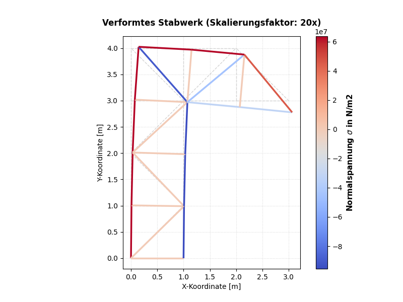

# FEM-Solver für Stabwerke

**Projekt von Louis Bösenberg**

Diese Anwendung ist eine eigene Umsetzung eines FEM-Solvers zur Berechnung von 2D-Stabwerken. Das Programm berechnet Verschiebungen, Dehnungen, Spannungen und Lagerkräfte und visualisiert die Ergebnisse.

---

## Projektstruktur & Modelle

Im Ordner `model_files/` sind die drei vorkonfigurierten Testsysteme hinterlegt:

* **Der Kran:** 13 Knoten, 23 Elemente (Datei: `crane_node_file.py`)
* **Die Brücke:** 15 Knoten, 28 Elemente (Datei: `bridge_node_file.py`)
* **Der Turm:** 13 Knoten, 26 Elemente (Datei: `tower_node_file.py`)

## Ausführung & Bedienung

1. **Bibliotheken installieren:** Falls benötigte Bibliotheken fehlen, kann das Jupyter-Notebook `imports.ipynb` ausgeführt werden. Es enthält zudem Links zu den jeweiligen Dokumentationen.
2. **Berechnung starten:** Das Hauptskript ist `script.py`.
3. **Modell wechseln:** Nach dem Start kann in der Konsole das gewünschte Modell ausgewählt werden.

## Auswertung & Ergebnisse

Nach dem Durchlaufen des Programms werden die Ergebnisse auf zwei Arten ausgegeben:

* **Grafische Oberfläche (Matplotlib):** Zeigt das verformte System (automatisch skaliert) eingefärbt nach den Normalspannungen im Vergleich zum unverformten Zustand.
  > *Hinweis zur Skalierung:* Der Skalierungsfaktor ist für die drei Standardmodelle vordefiniert. Bei eigenen Modellen kann dieser manuell in der Funktion `plot()` im Skript `solver.py` hinzugefügt werden.
  >

* **Textdatei:** Im Ordner `model_files/` wird die Datei `framework_solution.txt` generiert. Diese enthält alle Werte für Knotenverschiebungen, Elementspannungen, Elementdehnungen und Lagerreaktionskräfte.
